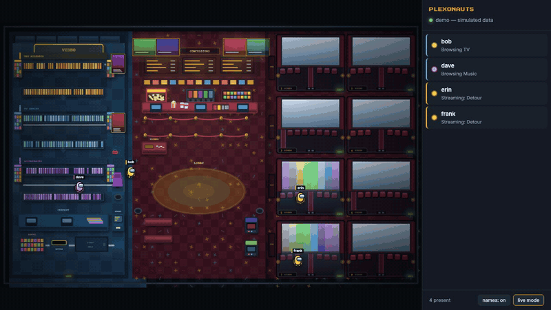

# Plexonauts — backend feed



*Demo mode with simulated users. [MP4 version](media/demo.mp4).*

Live per-user activity feed for the top-down "room" visualization — a retro movie theater where each viewer is an astronaut, running
against the Ubuntu Plex VM (`user@plex.lan`).

**Status as of 2026-09-13: working and verified against live data on that server.**

---

## Can it run on the new Plex server?

Yes, and it's a better fit than the original plan assumed. Four of the prompt's
prerequisites turned out to be already satisfied, and one assumption was wrong in
a way that would have cost real debugging time.

| Prerequisite | Reality on plex.lan |
|---|---|
| Debug logging enabled | **Already on** — 23,797 DEBUG lines in the current log |
| Log path | Correct as written, `/var/lib/plexmediaserver/.../Logs/Plex Media Server.log` |
| Root needed to read the log | **No** — it is `plex:plex` mode **644**, world-readable. The service runs unprivileged. |
| Node.js | **Not installed.** `python3` 3.12.3 is. Python chosen to avoid adding a runtime to a 4-vCPU / 8 GB box that also runs an 11 GB Plex DB and the media-health scans. |
| WebSocket library | `python3-websockets` 10.4 from apt. No pip, no venv, no other deps — everything else is stdlib. |
| Plex notification websocket | Works; real clients use `/:/websockets/notifications` on this server today. |

Measured cost: the Plex log grows ~555 KB/hour at idle with debug on. Tailing it
is cheap. The service adds one HTTP poll every 4s to Tautulli on localhost.

---

## Five things changed from the original plan

### 1. Sessions come from Tautulli, not from polling Plex directly

Tautulli is already running on this box (`:8181`, API enabled, 51,715 session
history rows) and already maintains a live connection to Plex doing exactly this
bookkeeping. Polling `/status/sessions` separately duplicates a running service
and adds load to a server that has a measured peak of 7 concurrent streams.

Tautulli's `get_activity` also returns more than the raw Plex endpoint: friendly
name, player, platform, transcode decision, progress.

### 2. No token harvesting — PMS already logs the username

The original plan was to parse `X-Plex-Token=` out of log lines and resolve each
token to a user via plex.tv, caching the mapping.

Don't. PMS stamps the account directly onto every request line:

```
Request: [192.168.1.100:54321 (WAN)] GET /library/sections/14/all ... Signed-in Token (alice)
```

The username is right there. The original approach would have meant building a
cache of **other people's live Plex credentials** to render a dashboard — an
unnecessary liability for zero benefit. This server has 35 distinct users in the
last 90 days.

### 3. The idle timeout would never have fired

This is the one that would have eaten an afternoon.

Idle Plex clients poll constantly. Measured on this server during a 3-minute
window: **12 distinct client IPs made requests, but only one was watching
anything.** A single idle app produced 77 `/media/providers` hits, and others sat
on `/:/eventsource/notifications` long-polls and `/photo/:/transcode` artwork
loads.

"Any request means the user is active" marks every connected client as
permanently busy, so a 25–30s idle timeout never triggers and the room fills up
with people who are actually asleep.

The fix is an explicit allow-list of genuine navigation (`BROWSE_PATHS`) plus a
deny-list of client chatter (`IGNORE_PATHS`) in `server.py`. Both lists are
derived from what this server actually logs, not guessed.

### 4. Three couches is undersized — use eight

From 1,215 sessions over 90 days:

| Concurrent streams | Share of busy time |
|---|---|
| ≥ 2 | 53.4% |
| ≥ 3 | **19.3%** |
| ≥ 4 | 5.4% |
| ≥ 7 | 0.3% |
| **Peak observed** | **7** |

With `tv1/tv2/tv3` only, roughly one busy moment in five has a streamer with
nowhere to sit. Backend defaults to `COUCHES=8` and emits `tv1`…`tv8`; anything
beyond that gets `tv_overflow` rather than vanishing.

**The frontend needs matching couch zones added** — it currently defines three.

Peak viewing hours here are 20:00, 22:00, 19:00 local.

### 5. Log rotation must be handled, and now matters more than before

PMS rotates its log on every restart. Since the auto-updater installed on
2026-09-12 restarts Plex at 4am whenever there's a new release, a tailer holding
a stale file descriptor goes **permanently deaf with no error**. `tail_log()`
re-stats the path and compares inodes.

---

## Verified behaviour

Run against the live server, not reasoned about:

| Test | Result |
|---|---|
| WebSocket connect + snapshot | `SNAPSHOT: 0 user(s)`, matching a genuinely idle server |
| Browse a movie section | `alice / movies / Browsing Movies` |
| Browse a TV section | zone correctly switches to `tv` |
| Keepalive noise (`/media/providers` ×3, `/status/sessions`, `/identity`) | **0 events — suppressed correctly** |
| Idle transition with keepalive traffic ongoing | browse at t+3s → **idle at t+47s** (TTL 45s + poll) |

That last row is the one that matters: the original design would have held that
user "active" forever.

---

## Viewing it

**Open <http://plex.lan:8787/> from any device on the LAN.** Nothing to install,
no tunnel.

The page and the WebSocket are served from the **same port** by the same process:
a non-upgrade request gets `viewer.html`, an upgrade request becomes the feed.
One service, one port, and the page always reaches its own feed regardless of
which host or IP you loaded it from — `viewer.html` derives the socket URL from
`location`, so it works over the LAN, through an ssh tunnel, or from `file://`.

`GET /healthz` returns `ok` for monitoring.

The viewer has two toggles in the footer:

- **demo mode** — simulates traffic, so the room is reviewable when the server
  is quiet. Uses `/art/demo`, a real library backdrop, so it exercises the same
  artwork path as a live stream.
- **names: on / off** — replaces real usernames with stable `Guest N` aliases in
  both the map and the roster, for showing the app to other people. Colours and
  positions are unchanged, so you can still follow an individual around. Works in
  live mode as well as demo. The choice is remembered per viewer in
  `localStorage` and survives a reload.

  Note it hides **identities, not content**: the roster still shows what is
  playing. Say the word if titles should be masked too.


### Idle visitors never overlap

Three mechanisms, in order of how much they are relied on:

1. **Reserved stops.** The lobby has 18 stops across concessions, benches,
   arcade and open floor. Each is held by at most one visitor, so destinations
   are distinct by construction. Concessions is an ordered queue — lower `q` is
   nearer the front — filled front-first, so it reads as a line.
2. **Direct routing.** Only the concession queue takes a detour (around the
   right-hand end of the velvet ropes, which must not be crossed); everything
   else walks straight. An earlier version routed *everything* through a single
   lobby hub, which funnelled the whole room through one point and made the
   crowding worse, not better.
3. **Hard separation constraint.** After movement each frame, any pair closer
   than `MIN_SEP` (30px) is pushed apart to exactly that distance, repeating
   until nothing moves so chains resolve. This is a positional constraint, not
   a steering force — it cannot be partially satisfied. Reservations alone were
   not enough because walkers still crossed paths in transit.

More idle visitors than stops is handled: extras take an unreserved spot on the
open floor and the constraint keeps them clear.

Measured with 20 idle users (2 past stop capacity), sampled every 200ms for
~42s including transit: **worst separation ever observed 30px, zero samples
below 28px.**

This is presentation only. Which zone a user is in still comes entirely from the
feed; this decides only where inside the lobby they stand.

## Running it

Installed as a systemd unit, enabled at boot:

```bash
sudo systemctl status plexonauts
```

```bash
sudo journalctl -u plexonauts -f
```

Unit file is `plexonauts.service` in this folder, installed to
`/etc/systemd/system/`. Runs as `user` (not root), with `NoNewPrivileges`,
`ProtectSystem=full`, and `ProtectHome=read-only` — it only needs to read a
world-readable log and talk to two localhost services.

`run.sh` is still there for foreground debugging; stop the unit first.

Config lives in `~/plexonauts/.env`, **mode 600**, holding the Tautulli API
key and the Plex token. Both were read server-side; neither is in this workspace
and neither has been printed.

### Exposure — read this once

`BIND_HOST=0.0.0.0`, so the page is reachable by anything on the LAN, and `ufw`
is inactive on that box. The feed pairs **real usernames with what they are
currently watching**. Anyone who can reach `plex.lan:8787` can read it, and
there is no authentication.

That is a deliberate choice for a home LAN, not an oversight. If it ever needs
narrowing, the options in increasing order of effort are: enable `ufw` and allow
8787 only from the trusted subnet; put it behind a reverse proxy with basic auth;
or set `BIND_HOST=127.0.0.1` and reach it through an ssh tunnel
(`ssh -N -L 8787:127.0.0.1:8787 user@plex.lan`).

---

## Visual overhaul (2026-09-13)

The viewer is now an illustrated top-down facility map rather than coloured
rectangles. **No location logic changed** — `server.py` was not touched for the
art pass, and the zone ids are exactly what it emits.

### Layers

| Layer | What |
|---|---|
| 1 environment | Static illustrated map, rendered **once** to an offscreen canvas and blitted per frame. Unlimited detail at near-zero per-frame cost. |
| 2 anchors | `ZONES`: `{id,x,y,w,h}` — the walkable floor a marker stands on. Unchanged contract. |
| 3 markers | User pins, always drawn above the art. |
| 4 overlay | Now-playing artwork, projector wash, lighting, vignette. |

Art functions only paint; `ZONES` alone decides where a marker goes. Either can
be replaced without touching the other. Auditoriums are drawn *from* the anchor
list so art and anchors cannot drift apart.

### Theme mapping (ids unchanged)

| Emitted id | Rendered as |
|---|---|
| `movies` | Video store — New Releases |
| `tv` | Video store — TV Series aisle |
| `music` | Video store — Soundtracks aisle |
| `idle` | Cinema lobby + concession stand |
| `tv1`…`tv8` | Auditoriums 1–8 |
| `tv_overflow` | *(no room)* — falls back to the lobby, see below |

The location names in the original brief (`movie_lobby`, `concessions`,
`video_checkout`, `video_backroom`…) do not exist in this system — Plex reports
library section types and stream slots, not concession stands. They were treated
as the theme to apply, not as identifiers to create.

### Now-playing artwork

Occupied auditorium screens show the **real backdrop of what is playing**.

- Backend pulls `art` (16:9 backdrop, falling back to `grandparent_thumb` /
  `thumb`) from the Tautulli session and emits `art: "/art/<rating_key>"`.
- `GET /art/<rating_key>` proxies the image from Plex **server-side**, so the
  Plex token never reaches the browser — which matters because the page is
  unauthenticated on the LAN.
- The route serves only rating_keys currently in `ART_PATHS`, populated from
  live sessions. It cannot be used to proxy arbitrary Plex paths. Verified:
  `/art/999999` → 404, `/art/..%2fetc` → 404.
- Images are cached in memory (capped) and sent with a 1-hour cache header.
- `/art/demo` resolves to a real library backdrop so demo mode exercises the
  same code path.
- If an image fails to load the screen falls back to the animated colour bars.

`screenRect(z)` is the single source of truth for screen geometry, shared by the
environment layer and the artwork overlay. Screens are **190x92** — the dominant
element of each house.

Artwork uses **contain fit**, not cover: the whole frame is always visible,
letterboxed against a black matte, never cropped. For a 640x360 backdrop on a
190x92 screen that draws 164x92 with 13px pillarbox bars.

### Auditorium geometry

Each auditorium carries two rects, deliberately separate:

- `room` — where the art is drawn
- `x/y/w/h` (the ZONE anchor) — the walkable floor, positioned **below the
  screen** so an enlarged screen can never cover a marker

Verified after each screen resize: all eight anchors resolve below their screen
rect, and marker presence was confirmed by sampling actual canvas pixels at each
marker position rather than by eyeballing a screenshot.

### Store legibility

Each section (`movies` / `tv` / `music`) has its own restrained palette — golds,
blues, purples — rather than every shelf drawing from one rainbow. That is what
lets the eye separate the three sections instead of reading one wall of noise.
Each gets a header bar, two shelf runs, a shaded aisle between them, and
endcaps.

### Overflow has no room of its own

Screen 9 was removed on request. `tv_overflow` is **not** in `ZONES`, so
`zoneOf()`'s existing idle fallback puts an overflow streamer in the **lobby** —
which reads correctly: every house is full, so they are waiting out front. The
roster still styles them as streaming, and `server.py` is unchanged, so the id
keeps working if it ever fires.

It is close to dead anyway: the backend only emits `tv_overflow` above 8
concurrent streams, and measured peak on this server is 7.

Verified by feeding the viewer a `tv_overflow` user: resolved to `idle`, landed
inside the lobby rect, still counted as streaming in the roster.

### Floor kept clean

No spilled popcorn, dropped tickets, litter cups, wet-floor signs or cleaning
carts. Those prop functions were removed outright rather than left as dead code.
`floorArrow` stays — it is floor paint, not litter.

### Marker legibility

Markers must stay readable over dense artwork, so each has a dark radial pool, a
pulsing halo in the user's colour, a ground ring, a black outline, and a name
plate with its own background. Verified after enlarging the screens: all eight
auditorium anchors resolve **below** the screen rect, so artwork never covers a
marker.

## Frontend integration

The mockup (`plex-activity-view.html`) is **not in this workspace** — it lives in
the environment where it was built. Bring it here and I'll wire it up.

Replace the `reassignAll()` / `setInterval` mock loop with:

```js
const ws = new WebSocket("ws://plex.lan:8787");   // localhost if served from the VM
const avatars = new Map();

function place(u) {
  let a = avatars.get(u.user);
  if (!a) { a = new Avatar(u.user); avatars.set(u.user, a); }
  a.setTarget(u.zone);
  a.detail = u.detail;
}

ws.onmessage = (ev) => {
  const m = JSON.parse(ev.data);
  if (m.type === "snapshot") m.users.forEach(place);
  else if (m.type === "activity") place(m);
};
ws.onclose = () => setTimeout(() => location.reload(), 5000);
```

All existing Avatar/draw/animation code stays untouched. Zone ids emitted are
`movies`, `tv`, `music`, `idle`, `tv1`…`tv8`, `tv_overflow`.

---

## Wire format

Snapshot on connect:

```json
{ "type": "snapshot", "users": [ { "user": "alice", "zone": "tv1", "detail": "Streaming: Dune: Part Two" } ] }
```

Delta on every change (only when a user's payload actually differs):

```json
{ "type": "activity", "user": "alice", "zone": "tv1", "detail": "Paused: Dune: Part Two" }
```

---

## Honest limitations

- **Browsing is best-effort.** It infers intent from HTTP paths. A user paging
  through a library looks identical to a client prefetching on their behalf. The
  stream signal is authoritative; the browse signal is decoration.
- **Section → zone mapping** covers movie/show/artist. Photo sections currently
  fall into `movies`.
- **No historical replay.** A client connecting mid-evening sees current state
  only. Tautulli has the history if that ever matters.
- **Not load-tested at peak.** Verified at 0–1 concurrent users. The 7-stream
  peak case has not been exercised end to end.

## Idle lobby roaming — 2026-09-13

Idle markers start at spaced destinations and stroll at 48 map pixels/second
between 15 stops on the clear floor beside the benches and arcade. They pause
5–15 seconds after arrival (4–12 initially). Destination selection favors space
from other idle users and their reserved destinations; very crowded rooms can
still overlap, and paths can cross. Feed status and roster text remain unchanged.
Browsing/streaming cancels roaming immediately; repeat idle updates do not reset it.

Deployed the viewer only, with no service restart. Syntax and a 120-second
simulation with 12 idle markers passed: distinct starting points, bounded travel,
and cancellation on streaming. HTTP-served SHA-256 matched the local file.
Browser visual inspection remains outstanding; the existing demo recording predates
this animation. Remote backup: `~/plexonauts/viewer.html.before-lobby-roaming`.

### Attraction visits (supersedes the floor-only roaming above)

Idle visitors now alternate between open floor, concessions, two bench stops and
both arcade machines. Waypoints go around the right end of the queue ropes.
Attractions have 12–26 second pauses, floor stops 5–12 seconds. Uncrowded
destinations are preferred; markers can still cross on shared routes. Feed status
remains idle. Deployed and HTTP hash verified; one-hour route simulation passed
for all four area types, obstacle bounds and streaming cancellation. Browser
visual review and updated demo capture remain outstanding.

### Astronaut markers — 2026-09-13

Users now appear as bean-shaped astronauts with their existing suit colors,
blue glass visors, backpacks and separate boots that step during movement.
Nameplates sit above the helmets. Drawn directly in canvas without image assets.
Deployed and visually checked on the live seven-user map at concessions, arcade
and an auditorium. Syntax and served-file hash checks passed.
